# RAVE FM 2 – The Manual

**An early hardcore groovebox firmware for the M-VAVE FM-1.**
Everything RAVE FM 2 does, where to find it and how to use it. If you are looking for a feature, use the table of
contents or search this page (Ctrl+F / Cmd+F) for the word you see on the screen.

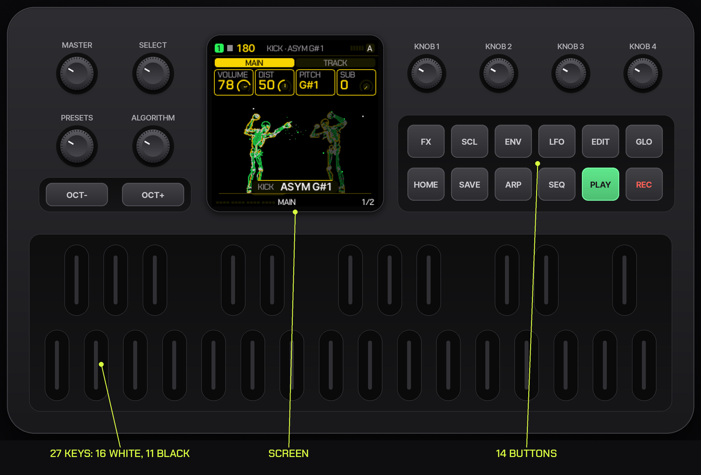

---

## Contents

1. [What RAVE FM 2 is](#1-what-rave-fm-2-is)
2. [Installing, updating, going back](#2-installing-updating-going-back)
3. [The panel](#3-the-panel)
4. [The screen](#4-the-screen)
5. [The big ideas: tracks, machines, sounds, patterns, projects](#5-the-big-ideas)
6. [Quick start: your first track in five minutes](#6-quick-start-your-first-track-in-five-minutes)
7. [Every button](#7-every-button)
8. [Every knob](#8-every-knob)
9. [The keys, depending on what you hold](#9-the-keys-depending-on-what-you-hold)
10. [HOME: the track's main pages](#10-home-the-tracks-main-pages)
11. [EDIT: the sound engines](#11-edit-the-sound-engines)
12. [SEQ: writing steps and melodies](#12-seq-writing-steps-and-melodies)
13. [REC: recording live](#13-rec-recording-live)
14. [ENV, LFO, ARP, SCL](#14-env-lfo-arp-scl)
15. [FX: each track's effects](#15-fx-each-tracks-effects)
16. [GLO: the mixer and the song's settings](#16-glo-the-mixer-and-the-songs-settings)
17. [LIVE FX: risers, drops, rolls, filters, mutes](#17-live-fx-risers-drops-rolls-filters-mutes)
18. [Patterns and the SONG](#18-patterns-and-the-song)
19. [Sidechain](#19-sidechain)
20. [Projects: save, load, name, undo, colours, lights](#20-projects-save-load-name-undo-colours-lights)
21. [MIDI and sync](#21-midi-and-sync)
22. [Your own samples](#22-your-own-samples)
23. [The sound lists](#23-the-sound-lists)
24. [Recipes](#24-recipes)
25. [Troubleshooting and FAQ](#25-troubleshooting-and-faq)
26. [Credits and licence](#26-credits-and-licence)

---

## 1. What RAVE FM 2 is

RAVE FM 2 turns the FM-1 into a groovebox built for **gabber, early hardcore, frenchcore, uptempo, terror and early
rave**. It is free and open source (GPL-3.0).

- **6 tracks**, each one any of these machines: **KICK**, **BREAK**, **909**, **SYNTH**, **ACID**
- **108 kick presets** built from 22 hardcore kick types, each with pitch, punch, length, distortion and envelope
- **Sliced breakbeats** (AMEN, THINK, HOT PANTS, plus your own samples)
- **A 909 kit** (11 pieces) on a drum engine with 12 kits
- **109 synth sounds**: rave leads, hoovers, screeches, stabs, basses, pads, plucks
- **12 acid (303) sounds**
- **4 patterns** (A-D), a **song** mode of 32 places, melodies up to **128 steps**, drums up to **64 steps**
- **Live recording** (REC) with grid, swing and metronome
- **Live FX on the keys**: riser (6 sounds to mix), 6 kinds of drop, rolls, filters, kill bass, tape stop, stutter, echo, mutes
- **Effects on every track**: drive, chorus, flanger, phaser, tremolo, ring mod / auto-wah / comp, EQ, plus a shared reverb and delay
- **Sidechain** on every track, pumped by the kick
- **6 projects** saved with a name, **6 colour themes**, key lights, MIDI in / out and clock

Out of the box the six tracks are: **1 KICK · 2 BREAK · 3 909 · 4 BASS · 5 LEAD · 6 STAB/HOOVER** (4, 5 and 6 are SYNTH tracks).

---

## 2. Installing, updating, going back

1. Download `RAVEFM2.fwsc` from the latest release on GitHub: <https://github.com/MorrisKraken/ravefm2/releases>
2. Install it like any FM-1 firmware: with the FM-1 installer you normally use (for example the one on
   [The Firmware Hub](https://thefirmwarehub.com)) over the USB-C cable. The update loader is inside the package.
3. The FM-1 restarts on the RAVE FM logo, then the HOME screen.

**Going back** to M-VAVE's official V15 (or any other firmware) works the same way: install the other `.fwsc`.
RAVE FM 2's package identity is `FM-1_180`.

> Your projects are kept in the FM-1's flash. Installing another firmware may erase them - keep that in mind before
> switching.

---

## 3. The panel

| Control | Its job in RAVE FM 2 |
|---|---|
| **MASTER** | The main volume (the FM-1's own) |
| **SELECT** | Moves through a section's pages (on HOME, EDIT, FX, GLO...). In SEQ: the cursor / page. On HOME with GLO held: the tempo |
| **PRESETS** | Browses the selected track's sounds (kicks, synth sounds, breaks...), each one heard as you turn |
| **ALGORITHM** | Selects the track (1 to 6) |
| **KNOB 1-4** | Set the four values shown in the four cards on the screen |
| **OCT- / OCT+** | The keyboard's octave. In SEQ: the page of 16 steps. In the menus: load / new. In TOOLS: do it / back |
| **The 14 buttons** | Open the sections (FX, SCL, ENV, LFO, EDIT, GLO, HOME, ARP, SEQ) and do things (SAVE, PLAY, REC) |
| **The 27 keys** | 16 white, 11 black: notes, steps, drum pieces, live effects, mutes - depending on what you hold (section 9) |

---

## 4. The screen

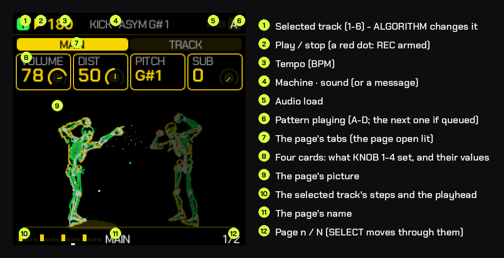

Every page is laid out the same way:

- **The header**: the selected track, play / stop (a red dot when REC is armed), the tempo, the machine and its
  sound (messages appear here too), the audio load, and the pattern playing (A-D; when you pick another one it
  shows the next one until the bar ends).
- **The tabs**: the pages of the section you are in. The lit one is open.
- **The four cards**: what KNOB 1, 2, 3 and 4 set right now, with their values.
- **The picture**: a drawing that shows what the page does (an envelope, a waveform, the steps, the mixer...) or the
  track's animated character.
- **The footer**: the selected track's steps with the playhead, the page's name and its number (n / N).

---

## 5. The big ideas

**Tracks.** There are 6. ALGORITHM selects one; everything you do (keys, knobs, SEQ, EDIT...) applies to the
selected track. The track number is in the header's green box.

**Machines.** Each track runs one sound engine: KICK, BREAK, 909, SYNTH or ACID. To change it, **hold EDIT and press a
white key**: W1 KICK, W2 BREAK, W3 909, W4 SYNTH, W6 ACID (section 9).

**Sounds (presets).** PRESETS browses the sounds of the track's machine. On a KICK track: the 108 kicks. On a SYNTH
track: the 109 synth sounds. On a BREAK track: the breaks and your samples. The 909 has one kit (change it in EDIT).

**Patterns.** A pattern holds the steps of all 6 tracks. There are 4: A, B, C, D. The sounds and the mix are the
same in every pattern; only the steps (and loop lengths) change. Switch in **GLO > GLOBAL > PATTERN**.

**Projects.** A project is everything: the 4 patterns, the sounds, the mix, the effects, the song, the tempo. 6
projects can be kept. **SAVE** saves; **hold HOME** opens the projects (section 20).

**Pages.** Each section (HOME, EDIT, FX, GLO...) has several pages. Press the section's button again to go to the
next group of pages, or turn **SELECT** to go page by page.

---

## 6. Quick start: your first track in five minutes

This is exactly what the demo video does.

**The kick**
1. Track 1 is selected (green **1** in the header). Turn **PRESETS** to hear the kicks; stop on one you like (for
   example **ASYM G#1**).
2. Press **SEQ**. Press the white keys **W1, W5, W9, W13**: a kick on every beat.
3. Press **PLAY**.
4. Press **HOME**: KNOB 3 (**PITCH**) tunes the kick to your song's key. **EDIT** three times opens **ENVELOPE**:
   KNOB 2 (**DECAY**) sets how long it rings.

**The break**
5. Turn **ALGORITHM** one click: track 2, BREAK. Press **HOME**, turn **KNOB 2** (BREAK) to choose it, for example
   **HOT PANTS**.
6. Press **SEQ** and press **W1** once: the break plays from step 1 and loops.

**The 909**
7. ALGORITHM one more click: track 3, the 909. You are still in SEQ. Press the black key **B3** (CP, the clap),
   then **W1 W5 W9 W13**. Press **B5** (OH, the open hat), then **W3 W7 W11 W15**.

**The melody**
8. ALGORITHM to track 5 (LEAD). Press **HOME**, turn **PRESETS** to **SLIDE V1**.
9. Press **SEQ**, turn **KNOB 3** (LOOP) up to **128** steps.
10. Press **HOME** to leave SEQ, press **REC** (it lights), and play your melody on the keys in time: it is recorded
    on the grid. Press **REC** again to stop recording.

**Play it live**
11. Hold **FX**: the keys become the live effects. Tap **W1** (RISER), then **W2** (DROP). Hold **W5** (FILTER LP).
    Tap the black keys **B1-B6** to mute and unmute tracks.

**Keep it**
12. **Hold HOME**, turn **SELECT** to the **NAME** page, write a name (KNOB 1 the letter's place, KNOB 2 the letter),
    press **SAVE**.

---

## 7. Every button

"Tap" = press and let go. "Hold" = keep it down (about half a second or more).

| Button | Tap | Hold | Held with keys / knobs |
|---|---|---|---|
| **HOME** | Back to the track's pages. Already there: next page (MAIN → MIX → TRACK) | Opens the **PROJECTS** menu | – |
| **EDIT** | The machine's sound pages. Again: next page | – | **+ white key**: changes the track's machine |
| **FX** | The track's effects pages. Again: next page | Hold ~0.5 s and let go without touching anything: **LIVE FX locked open** (tap FX to unlock) | **+ keys**: live effects and mutes. **+ KNOB 1-4**: RISER, ROLLS, CRASH, IMPACT levels |
| **GLO** | Mixer and global pages. Again: next page | – | **+ white keys**: mutes (W1-W6), solos (W9-W14). **+ PLAY**: tap tempo. **+ SELECT**: tempo |
| **SCL** | Scale and chords | – | **+ any key**: the root note |
| **ENV** | The envelope | – | – |
| **LFO** | The LFO | – | – |
| **ARP** | The arpeggiator's pages. In SEQ (melody): writes a **rest**. In NOTES: deletes the note | Alone: **arpeggiator on / off** | **+ keys** (outside SEQ): **NOTE REPEAT** (the key repeats at the ARP speed) |
| **SEQ** | The steps (WRITE). Again: **NOTES** (edit one by one). Again: **TOOLS**. Again: back to the steps | – | – |
| **SAVE** | Saves the project (in the PROJECTS menu: into the place chosen) | **UNDO** (hold again: redo) | – |
| **PLAY** | Play / stop | – | – |
| **REC** | Arms / disarms recording (the header shows a red dot) | Opens the **REC** settings page | – |
| **OCT- / OCT+** | Octave down / up (-3..+3). In SEQ (drums): previous / next 16 steps. In TOOLS: OCT+ does it, OCT- back. In NOTES: OCT- deletes. In PROJECTS: OCT+ load, OCT- new | – | **Both together**: octave back to 0 |

---

## 8. Every knob

| Knob | Normally | In SEQ | In TOOLS | With a button held |
|---|---|---|---|---|
| **SELECT** | Pages of the section (HOME pages included) | KNOB 1's job (cursor / page) | The tool | **GLO** (on HOME): tempo |
| **ALGORITHM** | Track 1-6 | Track | Track | – |
| **PRESETS** | The track's sounds | – | – | – |
| **KNOB 1-4** | The 4 cards on screen | Page/Cursor · Sound/Length · Loop · Grid/Transpose/Speed | Tool · setting · setting | **FX**: RISER · ROLLS · CRASH · IMPACT levels |

Knobs speed up when turned fast.

---

## 9. The keys, depending on what you hold

**Playing (nothing held, outside SEQ)** – the keys play the selected track. The lowest key is **F3** at octave 0.

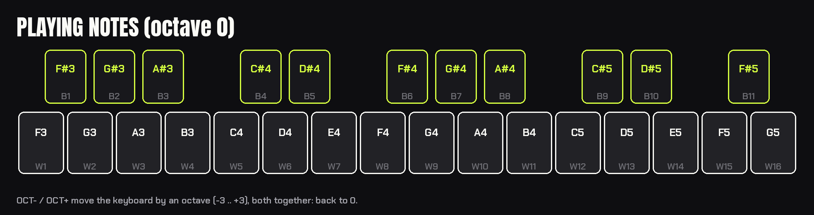

- On a **909** track, the white keys W1-W11 play the 11 pieces (BD SD CP CH OH MT RS CR LT HT RD).
- On a **BREAK** track, the lowest key plays slice 1, the next one slice 2, and so on.
- On a **KICK** track, the keys play the kick at different pitches.
- With **SCL > KEYS: SCALE**, the keys snap to the scale.

**In SEQ (kick, 909)** – the white keys are the 16 steps of the page shown; on the 909 the black keys choose the
piece you write.

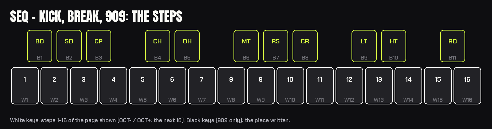

**FX held** – the live effects (section 17).

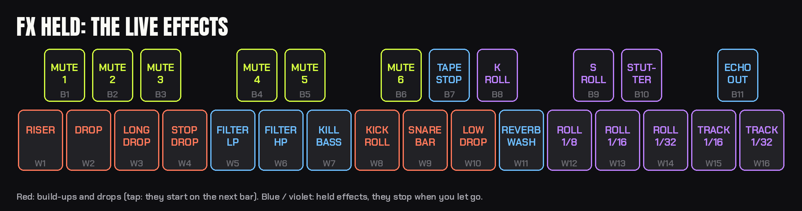

**GLO held** – mutes and solos.

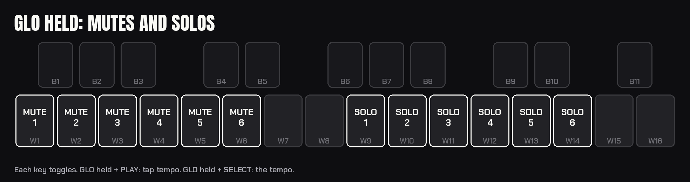

**EDIT held** – the machine. **SCL held** – the key you press becomes the root note.

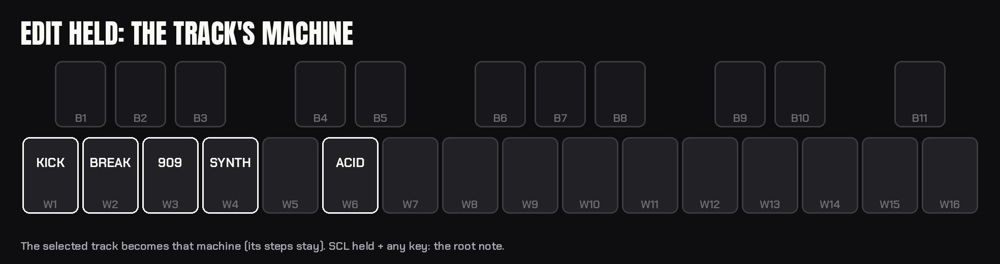

---

## 10. HOME: the track's main pages

Press **HOME** (or HOME again to move on, or SELECT). Each track has three pages - the kick has two.

| Machine | MAIN | MIX | TRACK |
|---|---|---|---|
| **KICK** | VOLUME · DIST · PITCH · SUB | – | STEPS · SPEED · FILTER · PAN |
| **BREAK** | VOLUME · BREAK · PITCH · TONE | FILTER · REVERB · DELAY · PAN | STEPS · SPEED · SIDECHAIN · TRANSPO |
| **909** | VOLUME · TUNE · DECAY · TONE | FILTER · REVERB · DELAY · PAN | STEPS · SPEED · SIDECHAIN · TRANSPO |
| **SYNTH** | VOLUME · CUTOFF · RESO · MACRO | FILTER · REVERB · DELAY · PAN | STEPS · SPEED · SIDECHAIN · TRANSPO |
| **SYNTH (rave leads*)** | VOLUME · CUTOFF · RESO · DISTO | FILTER · REVERB · DELAY · PAN | STEPS · SPEED · SIDECHAIN · TRANSPO |
| **ACID** | VOLUME · CUTOFF · RESO · ENVMOD | FILTER · REVERB · DELAY · PAN | STEPS · SPEED · SIDECHAIN · TRANSPO |

\* the first RAVE FM's leads (ANGER, SLIDE V1, SUPA DUPA...), which use the RAVE wave.

<table><tr>
<td>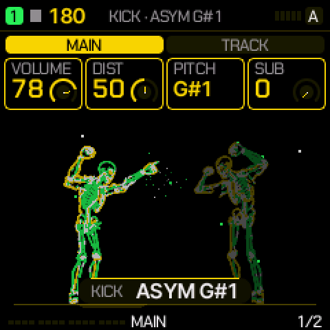 KICK · MAIN</td>
<td>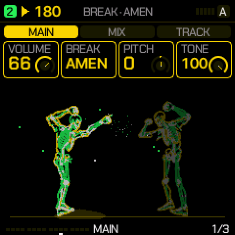 BREAK · MAIN</td>
<td>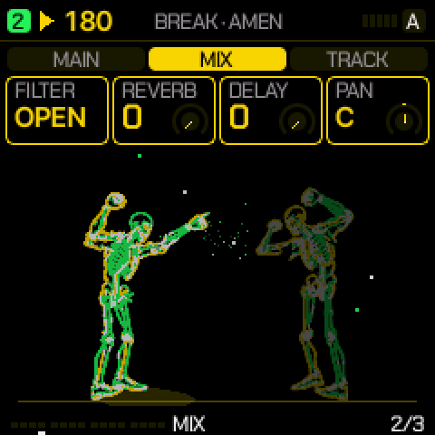 MIX (every track but the kick)</td>
</tr><tr>
<td>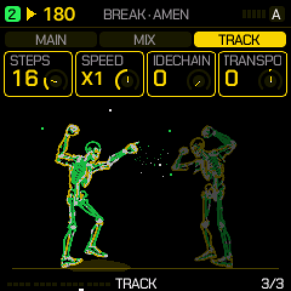 TRACK</td>
<td>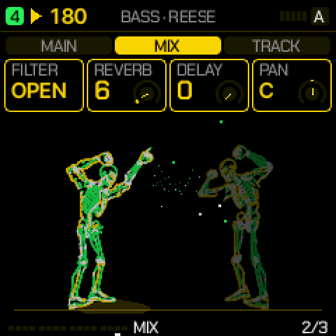 SYNTH · MIX</td>
<td>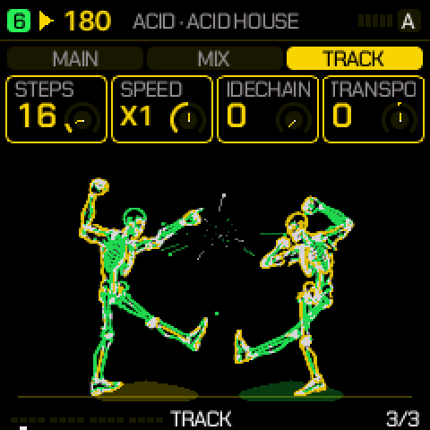 ACID · TRACK</td>
</tr></table>

- **VOLUME** – the track's level (also on GLO > MIXER).
- **FILTER** – one knob filter: centre = open, left = low-pass (darker), right = high-pass (thinner).
- **REVERB / DELAY** – how much of the track goes to the shared reverb and delay (set their type in FX).
- **PAN** – left / right.
- **STEPS** – the track's loop length (drums up to 64, melodies up to 128). Each track can have its own length.
- **SPEED** – x1/2, x1, x2: the track plays at half, normal or double speed.
- **SIDECHAIN** – how much the track ducks under each kick (section 19).
- **TRANSPO** – transposes the track's notes (±24 semitones).

---

## 11. EDIT: the sound engines

Press **EDIT**; press it again (or turn SELECT) for the next page. **PRESETS** loads a ready sound; EDIT changes it.

### 11.1 KICK

<table><tr>
<td>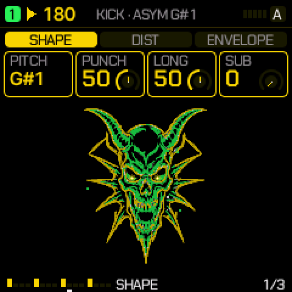 SHAPE</td>
<td>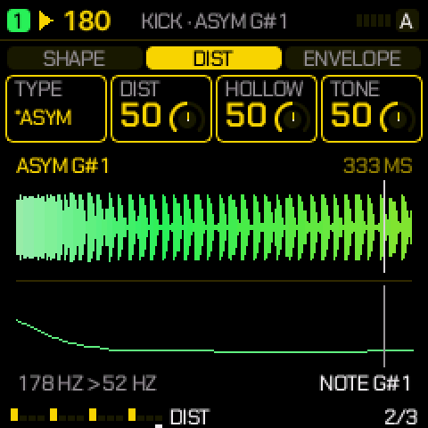 DIST</td>
<td>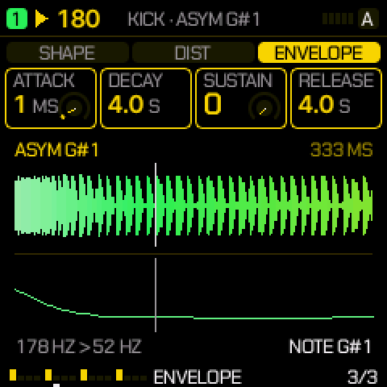 ENVELOPE</td>
</tr></table>

| Page | KNOB 1 | KNOB 2 | KNOB 3 | KNOB 4 |
|---|---|---|---|---|
| **SHAPE** | PITCH (the note) | PUNCH (the click / attack) | LONG (how long the tail lasts) | SUB (sub bass under it) |
| **DIST** | TYPE (22 kick types) | DIST (distortion) | HOLLOW (the hollow, "creux" sound) | TONE (bright / dark) |
| **ENVELOPE** | ATTACK | DECAY (how long it rings - its length) | SUSTAIN | RELEASE |

The DIST page draws the kick's waveform and its pitch sweep (from → to, in Hz) and its length in ms.

**Kick types** (DIST > TYPE): ROND, CREUX, PROF, NASAL, FUZZ, CASSE, ASYM, GABBR, MOKUM, TOK, TERRO, SPEED, UPTMP,
DOEF, EARLY, BELGE, DOOM, 909, BOOM, JUMP, JUMPD, BOUNC.

**Tuning the kick to your song**: HOME > MAIN > PITCH or EDIT > SHAPE > PITCH show the note (e.g. G#1). Most presets
have their note in their name (ASYM **G#1**, GABBER **A1**...).

**Making the kick shorter or longer**: EDIT > SHAPE > LONG, or EDIT > ENVELOPE > DECAY (with SUSTAIN at 0).

### 11.2 BREAK

<table><tr>
<td>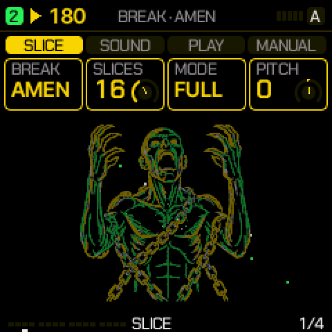 SLICE</td>
<td>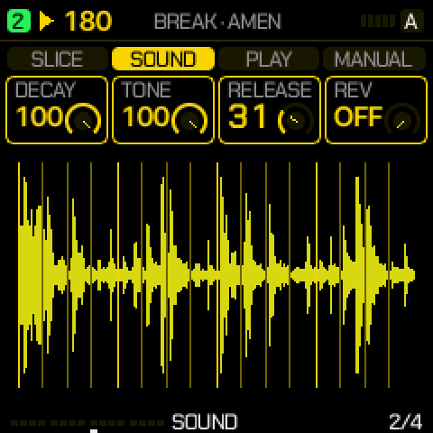 SOUND</td>
<td>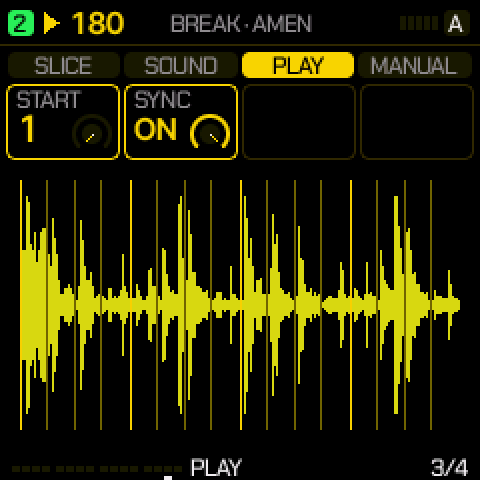 PLAY</td>
<td>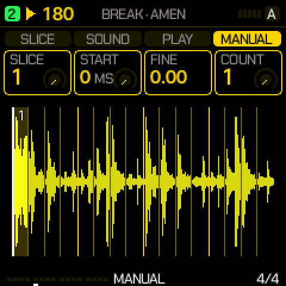 MANUAL</td>
</tr></table>

| Page | KNOB 1 | KNOB 2 | KNOB 3 | KNOB 4 |
|---|---|---|---|---|
| **SLICE** | BREAK (which break) | SLICES: 4, 8, 16, 32, AUTO, MAN | MODE: ONE, GATE, LOOP, FULL, DISQUE | PITCH (±24 semitones) |
| **SOUND** | DECAY | TONE | RELEASE | REV (backwards on / off) |
| **PLAY** | START (the slice it starts from) | SYNC (follows the tempo on / off) | – | – |
| **MANUAL** | SLICE (which one) | START (where it starts, ms) | FINE | COUNT (how many slices) |

- **SLICES** cuts the break into equal pieces; **AUTO** finds the hits; **MAN** uses the slices set on the MANUAL page.
- **MODE**: ONE = a slice plays once; GATE = as long as the key / step is held; LOOP = the slice loops; FULL = from the
  slice to the end of the break; DISQUE = like a record.
- **SYNC ON**: the break is stretched to the song's tempo.
- The simplest way to play a break: choose it, press **SEQ**, press **W1** - it plays from step 1 and loops with the
  track's STEPS.

### 11.3 909

<table><tr>
<td>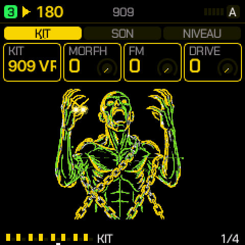 KIT</td>
<td>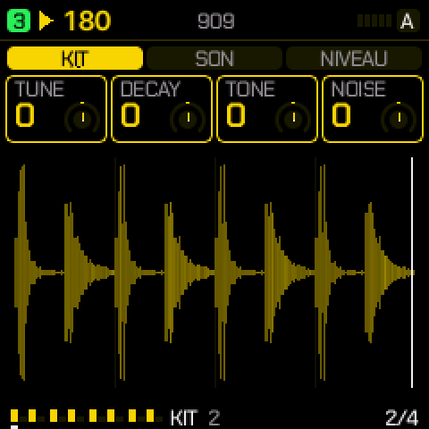 KIT 2</td>
<td>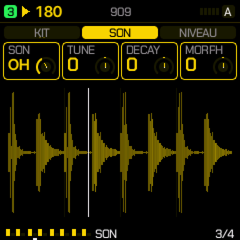 SON (the piece)</td>
<td>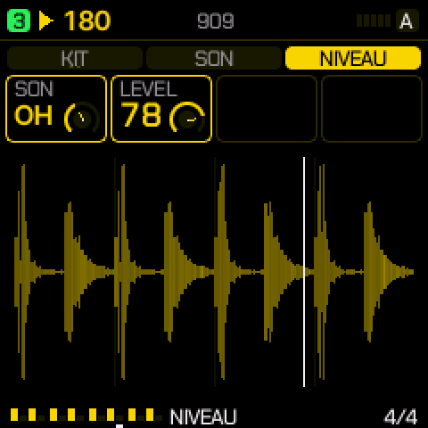 NIVEAU (level)</td>
</tr></table>

| Page | KNOB 1 | KNOB 2 | KNOB 3 | KNOB 4 |
|---|---|---|---|---|
| **KIT** | KIT (12 kits) | MORPH | FM | DRIVE |
| **KIT 2** | TUNE (whole kit) | DECAY (whole kit) | TONE (whole kit) | NOISE (whole kit) |
| **SON** | SON: the piece (BD SD CP CH OH MT RS CR LT HT RD) | TUNE (that piece) | DECAY (that piece) | MORPH (that piece) |
| **NIVEAU** | SON: the piece | LEVEL (that piece) | – | – |

**Kits**: 909 VRAI, DRUM-X, 909 CLUB, 808 BOOM, LOFI, INDUSTRY, ACOUSTIC, DUB, TECHNO, BREAKS, HIP HOP, LATIN.

Example: a brighter ride - EDIT > SON, KNOB 1 to **RD**, KNOB 2 (TUNE) to **+9**.

### 11.4 SYNTH

<table><tr>
<td>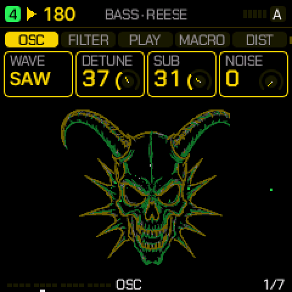 OSC</td>
<td>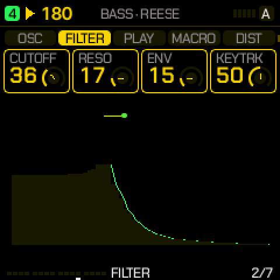 FILTER</td>
<td>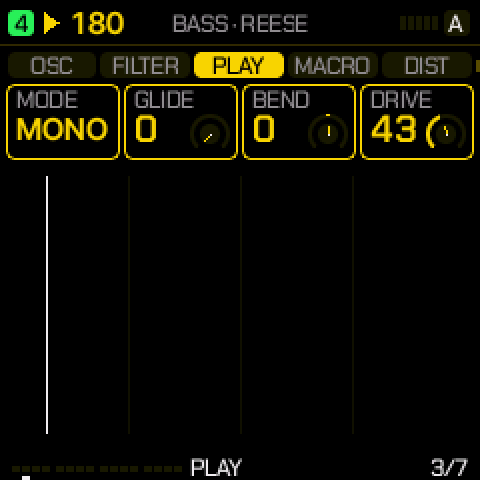 PLAY</td>
<td>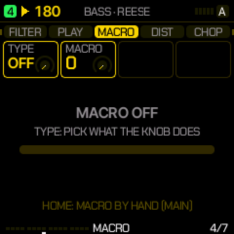 MACRO</td>
</tr><tr>
<td>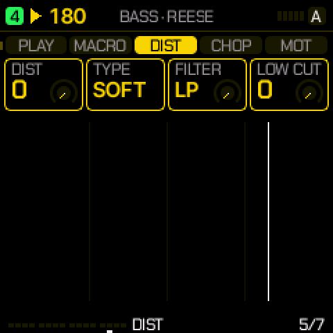 DIST</td>
<td>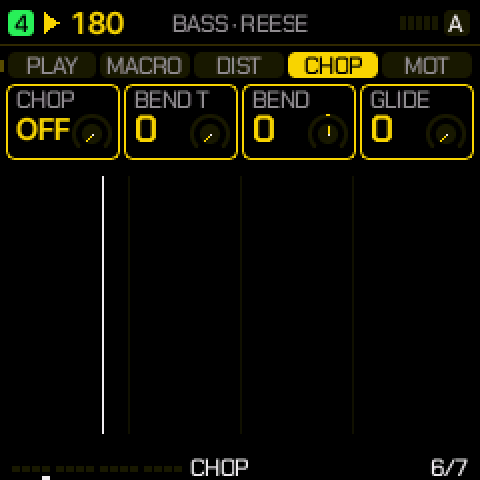 CHOP</td>
<td>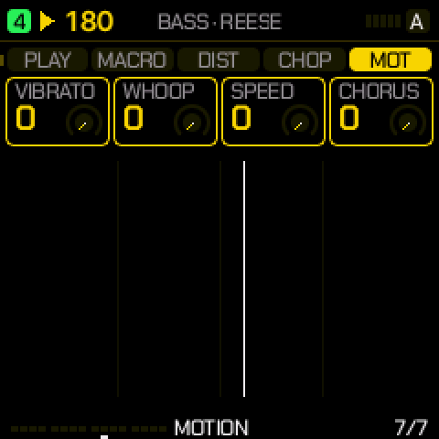 MOTION</td>
<td></td>
</tr></table>

| Page | KNOB 1 | KNOB 2 | KNOB 3 | KNOB 4 |
|---|---|---|---|---|
| **OSC** | WAVE (17 waves) | DETUNE* | SUB | NOISE |
| **FILTER** | CUTOFF | RESO | ENV (filter envelope amount) | KEYTRK (follows the notes) |
| **PLAY** | MODE: MONO, LEGATO, POLY | GLIDE | BEND | DRIVE |
| **MACRO** | TYPE: OFF, SCREECH, REESE, WOBBLE, GROWL | MACRO (the amount; also on HOME > MAIN) | – | – |
| **DIST** | DIST | TYPE: SOFT, HARD, FOLD, ASYM | FILTER: LP, BP, HP | LOW CUT |
| **CHOP** | CHOP: OFF, 1/8, 1/16, 1/32, 1/16T, SWING | BEND T (bend time) | BEND | GLIDE |
| **MOTION** | VIBRATO | WHOOP (the hoover's swoop) | SPEED | CHORUS |

\* DETUNE changes name with the wave: DRAWBARS (ORGAN), INDEX (FM, BELL), SYNC (SYNC), VOWEL (VOICE), RATIO (RING),
TIMBRE (M1), FOLD (FOLD), SPREAD (RAVE).

**Waves**: SAW, SQUARE, PWM, SUPER, HOOVER, SINE, ORGAN, FM, BELL, SYNC, VOICE, RING, STAB, M1, FOLD, HOOVER 2, RAVE.

### 11.5 SYNTH – the rave leads (RAVE wave)

The leads of the first RAVE FM (ANGER, SLIDE V1, SUPA DUPA, RAISE, GLISSE...) have their own pages:

<table><tr>
<td>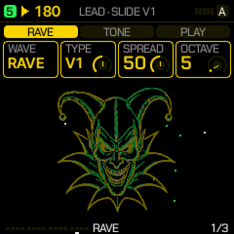 RAVE</td>
<td>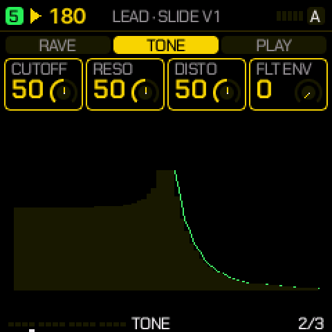 TONE</td>
<td>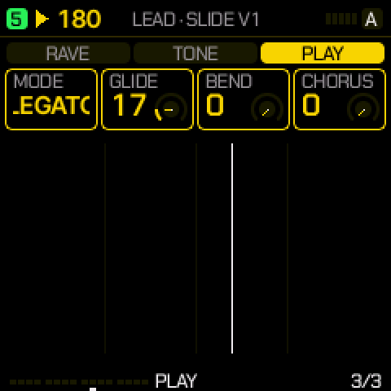 PLAY</td>
</tr></table>

| Page | KNOB 1 | KNOB 2 | KNOB 3 | KNOB 4 |
|---|---|---|---|---|
| **RAVE** | WAVE | TYPE: ANGER, V1, SUPA | SPREAD | OCTAVE |
| **TONE** | CUTOFF | RESO | DISTO | FLT ENV |
| **PLAY** | MODE | GLIDE | BEND | CHORUS |

These leads come with reverb as part of their sound: lower it on HOME > MIX > REVERB.

### 11.6 ACID (303)

<table><tr>
<td>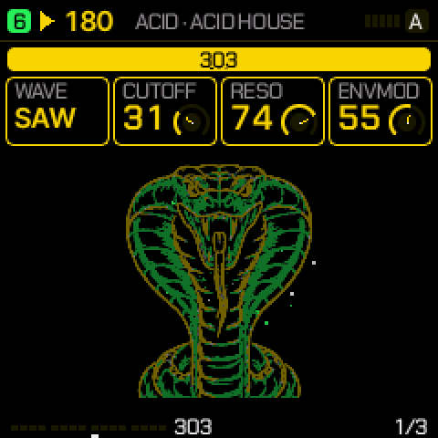 303</td>
<td>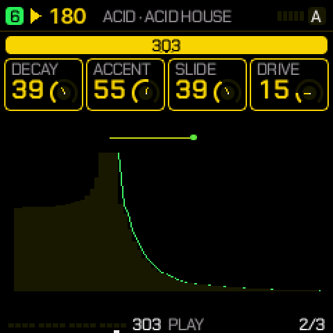 303 PLAY</td>
<td>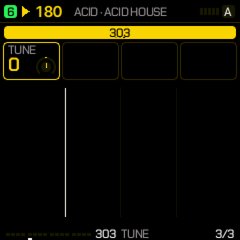 303 TUNE</td>
</tr></table>

| Page | KNOB 1 | KNOB 2 | KNOB 3 | KNOB 4 |
|---|---|---|---|---|
| **303** | WAVE: SAW, SQUARE | CUTOFF | RESO | ENVMOD |
| **303 PLAY** | DECAY | ACCENT | SLIDE | DRIVE |
| **303 TUNE** | TUNE | – | – | – |

### 11.7 Changing a track's machine

Select the track, **hold EDIT**, press a white key: **W1 KICK, W2 BREAK, W3 909, W4 SYNTH, W6 ACID**. The screen says
"MACHINE ...". Any track can be any machine: two kicks, two 909s, four synths...

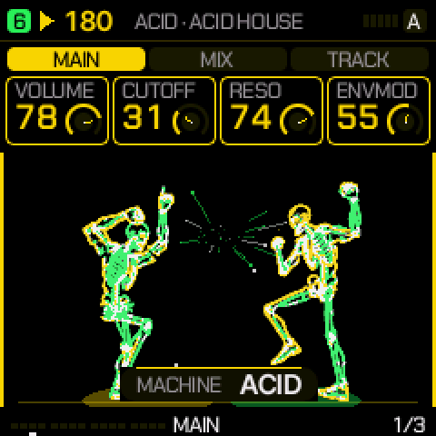

---

## 12. SEQ: writing steps and melodies

Press **SEQ**. Pressing it again cycles: **STEPS (write) → NOTES (edit) → TOOLS → STEPS**.
Leave SEQ with **HOME** (or any other section button).

### 12.1 Drum tracks: KICK and 909

<table><tr>
<td>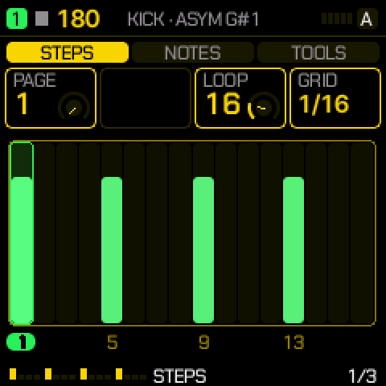 KICK</td>
<td>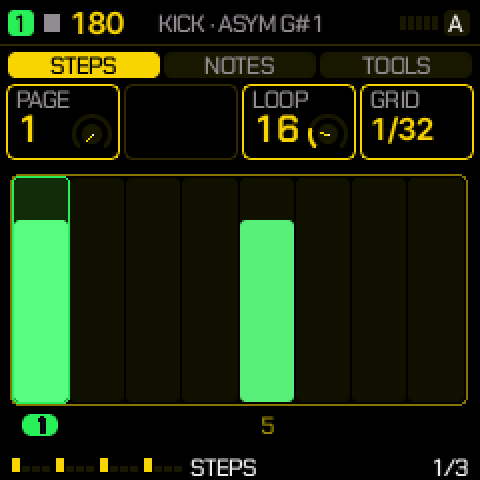 KICK, GRID 1/32</td>
<td>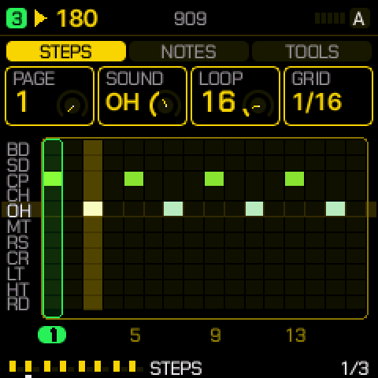 909</td>
</tr></table>

- **White keys W1-W16** = the 16 steps of the page shown: press to add a hit, press again to remove it. It is heard as
  you add it.
- **909**: press a **black key** first to choose the piece (B1 BD, B2 SD, B3 CP, B4 CH, B5 OH, B6 MT, B7 RS, B8 CR,
  B9 LT, B10 HT, B11 RD), then the white keys write that piece. The grid shows every piece on its own row.
- **OCT- / OCT+** = the previous / next page of 16 steps (when the loop is longer than 16).

| Knob | KICK / 909 |
|---|---|
| **KNOB 1** (or SELECT) | PAGE (which 16 steps) |
| **KNOB 2** | 909: SOUND (the piece, like the black keys) |
| **KNOB 3** | LOOP (length, up to 64 steps) |
| **KNOB 4** | GRID: 1/8, 1/16 (kick: also 1/32 - each key then has a half step after it) |

### 12.2 Melodic tracks: SYNTH, ACID, BREAK

<table><tr>
<td>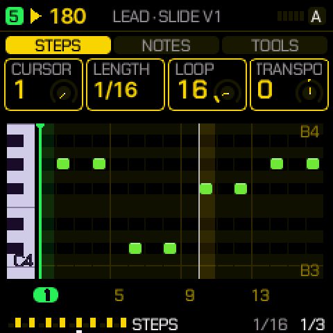 A melody, LENGTH 1/16</td>
<td>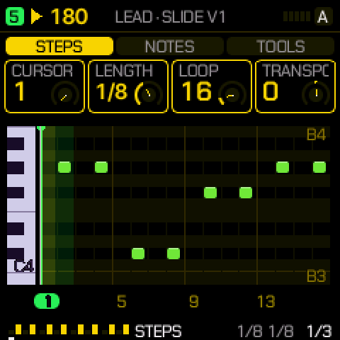 LENGTH 1/8</td>
<td>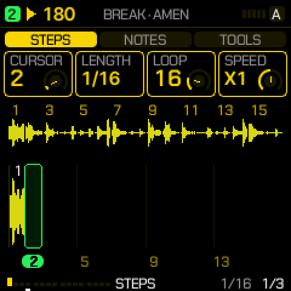 BREAK</td>
</tr></table>

Step by step, like a typewriter:

- **A key** writes that note at the **cursor**, as long as **LENGTH**, and the cursor moves on after it.
- **ARP** writes a **rest** (silence) as long as LENGTH and moves on.
- **Several keys held together** write a **chord** (up to 4 notes on one step).
- On a **BREAK** track the key is a slice: the lowest key = slice 1.

| Knob | Melodic tracks |
|---|---|
| **KNOB 1** (or SELECT) | CURSOR (where the next note goes) |
| **KNOB 2** | LENGTH: 1/32, 1/16, 1/8, 1/4, 1/2, 1/1 (how long each note is, and how far the cursor jumps) |
| **KNOB 3** | LOOP (length, up to 128 steps = 8 bars) |
| **KNOB 4** | TRANSPO (BREAK: SPEED) |

> **Important:** in SEQ the keys **write** notes step by step. To record a melody **in time** while the music
> plays, leave SEQ (press HOME) and use **REC** (section 13).

### 12.3 NOTES: editing note by note (SEQ twice)

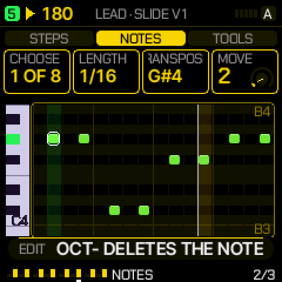

| Knob | Job |
|---|---|
| **KNOB 1** (or SELECT) | CHOOSE: goes from one note to the next (you hear it) |
| **KNOB 2** | LENGTH of that note |
| **KNOB 3** | TRANSPOSE: its pitch (kick: semitones; break: its slice; 909: its piece) |
| **KNOB 4** | MOVE: moves the note to another step |

- **A key** gives the chosen note that pitch (on the kick and the 909: chooses the hit on that step).
- **OCT-** (or **ARP**) deletes the chosen note.

### 12.4 TOOLS (SEQ three times)

<table><tr>
<td>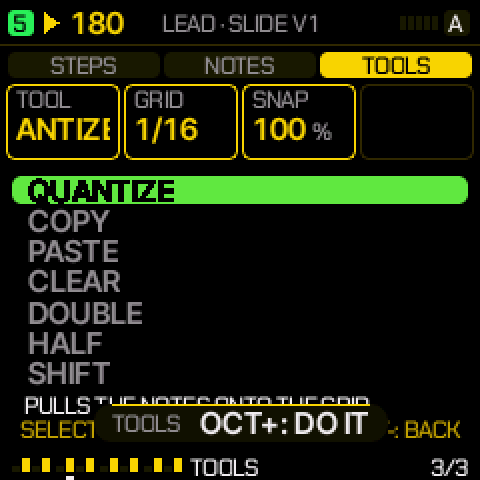 QUANTIZE</td>
<td>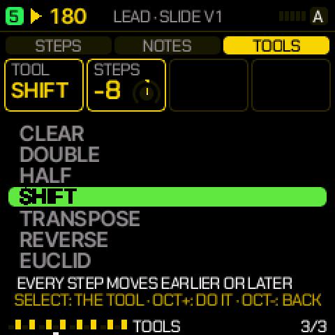 SHIFT</td>
<td>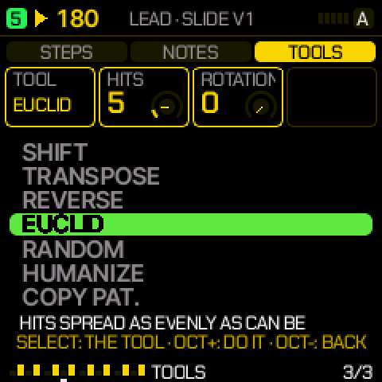 EUCLID</td>
</tr></table>

**KNOB 1** (or SELECT) chooses the tool, **KNOB 2 / KNOB 3** set it, **OCT+ does it**, **OCT-** goes back to the steps.
The tools work on the selected track (the PAT. ones on the whole pattern).

| Tool | What it does | KNOB 2 | KNOB 3 |
|---|---|---|---|
| **QUANTIZE** | Pulls the notes onto the grid | GRID: 1/32, 1/16, 1/8, 1/4 | SNAP: 25-100 % |
| **COPY** | Keeps the track in memory | – | – |
| **PASTE** | Puts back the track kept (also into another pattern) | – | – |
| **CLEAR** | Clears the track (909: only the piece picked) | – | – |
| **DOUBLE** | The loop twice as long, copied | – | – |
| **HALF** | Keeps the first half | – | – |
| **SHIFT** | Every step moves earlier or later | STEPS | – |
| **TRANSPOSE** | The notes go up or down | SEMITONES | – |
| **REVERSE** | The loop backwards | – | – |
| **EUCLID** | Hits spread as evenly as possible | HITS | ROTATION |
| **RANDOM** | A random rhythm or melody | DENSITY | – |
| **HUMANIZE** | Velocities a little random | AMOUNT | – |
| **COPY PAT.** | Keeps the whole pattern (every track) | – | – |
| **PASTE PAT.** | Puts the kept pattern back (e.g. into pattern B) | – | – |
| **CLEAR PAT.** | Clears every track of the pattern | – | – |
| **STYLE** | A ready rhythm: kick, 909, break | STYLE | TEMPO (also sets the tempo: ON / OFF) |

**STYLE** rhythms: GABBER (180), HAPPY HC (170), EARLY HC (165), FRENCHCORE (200), UPTEMPO (200), HARDTEK (180),
TERROR (240), SPEEDCORE (300), INDUSTRIAL (150), DOOMCORE (140), JUNGLE (170), BREAKCORE (180), RAVE 92 (140),
NEW BEAT (120), JUMPSTYLE (150), FRENCH LOOP (200).

---

## 13. REC: recording live

- **Tap REC**: armed (the button lights, a red dot in the header). Tap again: off.
- **While playing**: what you play on the keys (outside SEQ) is recorded **in time** into the selected track, pulled
  onto the grid. How long you hold a key is its length. Keys held together on one step make a chord.
- **While stopped**: arm REC, then PLAY starts recording (with a count-in if you set one).
- With the **arpeggiator** on, what the arp plays is recorded.
- **Hold REC**: the REC settings page (also GLO > REC).

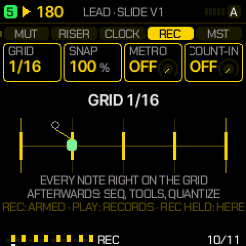

| Setting | Values |
|---|---|
| **GRID** | FREE (as played), 1/32, 1/16, 1/8 |
| **SNAP** | 100 % (right on the grid) ... 25 % (a little of your feel kept) |
| **METRO** | OFF, ON 1-4 (always, 4 levels), REC 1-4 (only while recording) |
| **COUNT-IN** | OFF, 1 BEAT, 2 BEATS, 1 BAR, 2 BARS |

**NOTE REPEAT**: hold **ARP** and hold a key: the note repeats at the ARP page's SPEED (recorded too if REC is on).

---

## 14. ENV, LFO, ARP, SCL

### ENV – the envelope

<table><tr>
<td>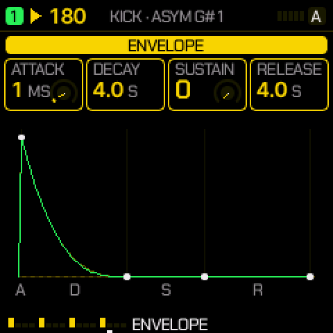 KICK, BREAK, 909, ACID</td>
<td> SYNTH: AMP ENV</td>
<td> SYNTH: FILTER ENV</td>
</tr></table>

ATTACK · DECAY · SUSTAIN · RELEASE. SYNTH tracks have two: AMP ENV (the volume) and FILTER ENV (the filter, amount set
on EDIT > FILTER > ENV). Attack starts at 1 ms on every sound (no click); you can still turn it to 0.

### LFO

<table><tr>
<td> LFO</td>
<td> LFO MODE</td>
</tr></table>

| Page | KNOB 1 | KNOB 2 | KNOB 3 | KNOB 4 |
|---|---|---|---|---|
| **LFO** | SHAPE: SINE, TRIANGLE, SQUARE, RAMP +, RAMP -, RANDOM | SPEED (free, or in beats when SYNC is on: 4 BARS ... 1/16T) | AMOUNT (0: nothing) | DEST: VOLUME, FILTER, PITCH, PAN, CUTOFF |
| **LFO MODE** | SYNC (to the tempo) | RETRIG (restarts on each note) | – | – |

### ARP – the arpeggiator

<table><tr>
<td> ARP</td>
<td> ARP PLAY</td>
</tr></table>

**Hold ARP** (alone) to switch it on / off; tap ARP for its pages.

| Page | KNOB 1 | KNOB 2 | KNOB 3 | KNOB 4 |
|---|---|---|---|---|
| **ARP** | MODE: OFF, UP, DOWN, UP-DOWN, DOWN-UP, H&B, RANDOM, PLAYED, CHORD, CONVERGE, DIVERGE | SPEED: 1/4, 1/8, 1/16, 1/32, 1/4T, 1/8T, 1/16T, 1/8., 1/16. | GATE | OCTAVES (1-4) |
| **ARP PLAY** | LATCH (keeps playing after you let go) | RHYTHM: ALL, 1 IN 2, GALLOP, x.xx, xx.x, x..x, xxx., 3-3-2, .x.x, x.x..x.x, xx..xx.., GABBER, x...x..., TRIPLE, SKIP, RANDOM | SWING | VELO: PLAYED, FIXED, BEAT, RISE |

### SCL – scale and chords

<table><tr>
<td> SCALE</td>
<td> CHORDS</td>
</tr></table>

| Page | KNOB 1 | KNOB 2 | KNOB 3 | KNOB 4 |
|---|---|---|---|---|
| **SCALE** | ROOT (C ... B) | SCALE | CHORD | INVERT (0-3) |
| **CHORDS** | VOICING: CLOSE, OPEN, WIDE | KEYS: FREE, SCALE | – | – |

- **Scales**: CHROMA, MAJOR, MINOR, HARM MIN, MELO MIN, DORIAN, PHRYGIAN, LYDIAN, MIXOLYD, LOCRIAN, PENTA MAJ, PENTA MIN,
  BLUES, HUNGARIAN, PHRYG DOM, JAPANESE.
- **Chords**: OFF, AUTO, AUTO 7, AUTO 9 (built from the scale), MIN, MAJ, MIN7, MAJ7, 7, DIM, AUG, SUS2, SUS4, FIFTH,
  OCTAVE. One key then plays the whole chord (and SEQ / REC write it).
- **KEYS: SCALE** snaps every key to the scale - no wrong note.
- **SCL held + a key**: that key becomes the ROOT.

---

## 15. FX: each track's effects

Tap **FX** (the selected track's chain; FX again or SELECT for the next page). All effects play together, in this
order. On every page **KNOB 1 is how much (0 = off) or which type**.

<table><tr>
<td> DRIVE</td>
<td> CHORUS</td>
<td> FLANGER</td>
<td> PHASER</td>
<td> TREMOLO</td>
</tr><tr>
<td> EXTRA</td>
<td> EQ</td>
<td> REVERB</td>
<td> DELAY</td>
<td> ROUTE</td>
</tr></table>

| Page | KNOB 1 | KNOB 2 | KNOB 3 | KNOB 4 |
|---|---|---|---|---|
| **DRIVE** | TYPE: OFF, OVERDRIVE, DIST, FUZZ, LO-FI, FOLD | GAIN (LO-FI: BITS; FOLD: FOLD) | TONE (LO-FI: RATE; FOLD: SYMM) | MIX |
| **CHORUS** | AMOUNT | SPEED | DEPTH | – |
| **FLANGER** | AMOUNT | SPEED | DEPTH | RETURN (feedback) |
| **PHASER** | AMOUNT | SPEED | DEPTH | RETURN |
| **TREMOLO** | AMOUNT | SPEED | SHAPE | – |
| **EXTRA** | TYPE: OFF, RING, AUTO-WAH, COMP | RING: FREQ · WAH: DIR · COMP: AMOUNT | RING: SPEED · WAH: RESO · COMP: SPEED | MIX (COMP: GAIN) |
| **EQ** | LOW | MID | HIGH | – |
| **REVERB** | AMOUNT (this track) | TYPE: ROOM, HALL, PLATE, CAVE, GATED (all tracks) | SIZE (all) | DAMP (all) |
| **DELAY** | AMOUNT (this track) | BEAT: 1/16, 1/8, 1/8., 1/4, 1/8T, 1/4T, 1/4. (all) | REPEATS (all) | TYPE: PING, STEREO, MONO, TAPE, DUB (all) |
| **ROUTE** | EFFECT (which one moves) | PLACE (1-5 in the chain) | PATH: IN LINE / SPLIT | REV+DLY: AFTER / SPLIT |

- **REVERB and DELAY are shared**: AMOUNT is this track's send; the rest is the same for every track.
- **ROUTE**: changes the order of DRIVE, FLANGER, PHASER, TREMOLO, EXTRA. **SPLIT** puts an effect beside the chain (on
  the clean sound, mixed back at the end). REV+DLY **SPLIT** sends the clean sound to the reverb and delay. The chorus
  and the EQ always stay last.

---

## 16. GLO: the mixer and the song's settings

Tap **GLO**; GLO again or SELECT for the next page. 11 pages:

<table><tr>
<td> MIXER 1-4</td>
<td> MIXER 5-6</td>
<td> GLOBAL</td>
<td> SONG</td>
</tr><tr>
<td> DROP</td>
<td> DROP +</td>
<td> MUTATIONS</td>
<td> RISER</td>
</tr><tr>
<td> CLOCK</td>
<td> REC</td>
<td> MASTER</td>
<td></td>
</tr></table>

| Page | KNOB 1 | KNOB 2 | KNOB 3 | KNOB 4 |
|---|---|---|---|---|
| **MIXER 1-4** | Track 1 volume | Track 2 | Track 3 | Track 4 |
| **MIXER 5-6** | Track 5 volume | Track 6 | – | – |
| **GLOBAL** | TEMPO (60-300) | SWING | TRANSPO (the whole song) | PATTERN (A-D) |
| **SONG** | SLOT (1-32) | PATTERN (A-D, or END) | BARS (1-64) | PLAYS: LOOP / CHAIN |
| **DROP** | DROP (which kind its knobs set) | LENGTH: 1, 2, 4, 8 BARS | ROLL: NONE, SNARE, SNARE x2, KICK, FILL, KICK+SN | FILTER: NONE, RISING, SINKING |
| **DROP +** | DROP (which kind) | KICK: OUT / IN | END: CRASH, CUT+CRASH, CUT, NONE | – |
| **MUTATIONS** | AMOUNT | FILLS: every 4, 8, 16 BARS | TRACKS: ALL, KICK, 909, BREAK | ACTIVE: OFF / ON |
| **RISER** | SOUND: CLASSIC, NOISE, WIND, SIREN, SAW UP, SNARE ROLL, MUSIC | LEVEL (that sound; MUSIC: FILTER on / off) | LENGTH: 1, 2, 4, 8 BARS | END: PLAIN, BREATH, IMPACT, BOTH |
| **CLOCK** | SYNC: INT / MIDI | MIDI OUT: OFF / ON | – | – |
| **REC** | GRID | SNAP | METRO | COUNT-IN |
| **MASTER** | LOW | MID | HIGH | DRIVE (the whole mix) |

- **The mixer** shows every track's level as it plays (the meters) and its name.
- **DROP pages**: KNOB 1 chooses which drop you are setting (DROP, KICK ROLL, SNARE, LOW, STOP, LONG) - each one is
  played by its own white key with FX held (section 17).
- **MUTATIONS**: the kick, 909 and break vary as they play (extra hits, ghost notes, slices moved, fills every few
  bars) - your steps stay as they are. Turn **ACTIVE** on.
- **RISER**: KNOB 1 picks one of its sounds, KNOB 2 sets that sound's level (0 = off). **Mix as many as you like**:
  e.g. CLASSIC 40 % + WIND 75 % + SNARE ROLL 50 %. The last line, **MUSIC**, filters the music up under the riser (on /
  off). **END**: PLAIN, BREATH (a beat of silence before the drop), IMPACT (a hit), BOTH.

**Tempo shortcuts**: on the HOME screen, **GLO held + SELECT** sets the tempo; **GLO held + PLAY** (tapped several times) = **tap tempo**.

---

## 17. LIVE FX: risers, drops, rolls, filters, mutes

**Hold FX**: the keys become live effects and the screen shows their map. Let go of FX and the keys play again.

<table><tr>
<td> FX held</td>
<td> FILTER LP held</td>
</tr></table>

**White keys**

| Key | Effect | How |
|---|---|---|
| **W1** | **RISER** – the build-up (its sounds and length: GLO > RISER) | Tap: starts on the next bar. Tap again: cancelled |
| **W2** | **DROP** – the breakdown (GLO > DROP) | Tap: from the next bar (tap again: cancelled) |
| **W3** | **LONG DROP** | Tap |
| **W4** | **STOP DROP** | Tap |
| **W5** | **FILTER LP** – sweeps a low-pass down | Hold; let go to come back |
| **W6** | **FILTER HP** – sweeps a high-pass up | Hold |
| **W7** | **KILL BASS** – takes the low end out | Hold |
| **W8** | **KICK ROLL** (a drop kind: a kick roll over the bars) | Tap |
| **W9** | **SNARE BAR** – a snare roll to bring it back | Tap |
| **W10** | **LOW DROP** – the bass dropped out, then back | Tap |
| **W11** | **REVERB WASH** – everything into the reverb | Hold |
| **W12-W14** | **ROLL 1/8, 1/16, 1/32** – the whole mix repeated | Hold |
| **W15-W16** | **TRACK 1/16, 1/32** – only the selected track repeated | Hold |

**Black keys**

| Key | Effect |
|---|---|
| **B1-B6** | **Mute / unmute** tracks 1-6 (tap) |
| **B7** | **TAPE STOP** – the music slows down like a record stopped by hand (hold) |
| **B8** | **KICK ROLL** – the kick rolls instead of playing (it replaces the kick, never both) (hold) |
| **B9** | **SNARE ROLL** (hold) |
| **B10** | **STUTTER** (hold) |
| **B11** | **ECHO OUT** – everything into the delay for a beat (hold) |

**The knobs while FX is held**: KNOB 1 **RISER**, KNOB 2 **ROLLS**, KNOB 3 **CRASH**, KNOB 4 **IMPACT** – how loud
those sounds are (0-100 %).

**FX locked open**: hold FX about half a second **without touching anything**, then let go: the screen says
"FX LOCKED" and the live effects stay on the keys, hands free. **Tap FX** to unlock.

---

## 18. Patterns and the SONG

**Switching patterns**: GLO > GLOBAL > **PATTERN** (KNOB 4). While playing, the new pattern starts at the end of the
bar (the header shows it waiting).

**Making pattern B from pattern A**: in pattern A, SEQ ×3 > **COPY PAT.** > OCT+. Switch to B. SEQ ×3 > **PASTE PAT.** >
OCT+. Then change what you want in B. (For one track only: COPY / PASTE.)

**The SONG** (GLO > SONG) chains the patterns:
1. **SLOT** (KNOB 1) chooses a place, 1 to 32.
2. **PATTERN** (KNOB 2) sets which pattern plays there (A-D), or **END**.
3. **BARS** (KNOB 3) how many bars it plays (1-64).
4. **PLAYS** (KNOB 4): **LOOP** = the pattern chosen in GLOBAL loops (the chain waits); **CHAIN** = PLAY starts the
   song from slot 1 and follows the chain.

---

## 19. Sidechain

Every track (except the kick itself) can **duck under the kick**: at each kick heard, the track goes down in 1 ms,
stays down a moment and comes back up over three sixteenths - the classic pump. It also pumps on the KICK ROLLs.

- Select the track (break, lead, stab...).
- **HOME → TRACK** page (HOME three times), turn **SIDECHAIN** (KNOB 3): 0 = off, 100 % = fully down at each kick.
- It is 0 on every track out of the box.
- A muted kick does not pump.

---

## 20. Projects: save, load, name, undo, colours, lights

**Hold HOME** to open the projects (PROJECTS page and NAME page).

<table><tr>
<td> PROJECTS</td>
<td> NAME</td>
</tr></table>

| Page | KNOB 1 | KNOB 2 | KNOB 3 | KNOB 4 |
|---|---|---|---|---|
| **PROJECTS** | PROJECT (place 1-6) | SAMPLES (your samples kept) | LUMIERE (key lights) | COLOUR (theme) |
| **NAME** | NAME: the letter's place (shown in [ ]) | LETTER (A-Z, 0-9, -, space) | – | – |

- **Save**: tap **SAVE** anywhere – the project goes to its place ("PROJECT n · SAVED"). In the PROJECTS menu, SAVE
  saves into the place chosen with KNOB 1 (if that place is used, it asks: press SAVE again).
- **Load**: in PROJECTS, choose the place with KNOB 1, press **OCT+** (it asks), press **OCT+** again.
- **New project**: in PROJECTS, press **OCT-** twice. It goes into the first empty place.
- **Name**: NAME page, KNOB 1 picks the letter's place, KNOB 2 the letter (8 letters), then **SAVE**. The tiles
  show each project's name.
- **Undo**: **hold SAVE** – the last run of changes is undone. Hold SAVE again: redo.
- **LUMIERE** (key lights): TOUT (all), MENU (the menu buttons), CLAVIER (the keys), ETEINT (off).
- **COLOUR**: NEON, ACIDE, TOXIC, FEU, SPECTRE, VIOLET – the whole screen's palette.

<table><tr>
<td> NEON</td>
<td> ACIDE</td>
<td> TOXIC</td>
<td> FEU</td>
<td> SPECTRE</td>
<td> VIOLET</td>
</tr></table>

The PROJECTS page also shows the CPU load and any audio dropouts at the bottom.

---

## 21. MIDI and sync

Over the USB-C cable:

- **Notes in**: MIDI notes coming in play the **selected track**. On a 909 track, General MIDI drum notes (35-51)
  play the matching pieces.
- **Clock in**: GLO > CLOCK > **SYNC: MIDI** – the tempo, start and stop follow the incoming MIDI clock.
- **Clock out**: GLO > CLOCK > **MIDI OUT: ON** (with SYNC: INT) – RAVE FM 2 sends start, stop and 24 clocks a beat.

---

## 22. Your own samples

RAVE FM 2 can take your own sounds: they appear in the BREAK track's list (PRESETS, and EDIT > SLICE > BREAK), after
the built-in breaks.

They are sent from a phone with the sampler page that comes with the source code (`web/sampler.html`): record with
the phone's microphone or pick a file, trim it, and send it to the FM-1 over the USB-C cable (Web MIDI: Android with
Chrome; an iPhone's Safari has no Web MIDI). Sounds are stored at 16 kHz mono.

**PROJECTS > SAMPLES** shows how many of your samples are kept; turning it down removes the last ones.

---

## 23. The sound lists

**Kicks (108)** – PRESETS on a KICK track:
ROUND, ROND F#1, BOUM D#1, HOLLOW, RTD 93 F#1, CREUX RTD G1, CRX LONG F1, COURT SEC A1, FUZZ, FUZZ SALE G1, FZ NASAL A1,
INDUS F#1, TWISTED, ASYM G#1, HARD ROUND, GABB DUR A#1, GABBER A1, GABB ROND F1, LASER A1, NASAL, NAS AIGU B1, MOUTH,
MOKUM A#1, MKM SALE B1, MKM LONG G#1, FAST, UPTEMPO C#2, MONSTER, CASSE F#1, CRX CASS G#1, SLAP, BELGE 91 G1, DARK,
DOOMCORE D1, SIMPLE, 909 SAT B1, 909 PUR G1, BOOM, BOUNCE, JUMPSTYLE G1, HARD BOUNCE, BOUNCE A1, BNC ROND F1, ROUND
BOUNCE, HOWLER, ZAAG, FRENCHY, ELASTIC, RATTLE, STEEL, GRIZZLY, CRUNCHY, MIXER 909, TRACKER CLIP, POING, HAPPY PUNCH,
RECTIFIED, NIGHTMARE, BROKEN SAMPLE, JUNO THUMP, STOMPER, CLIPPED SQUARE, NU STYLE, RESO DROP, FLAM KICK, PUNCHER,
ENDLESS, FIGHTER, KNOCKER, NOISE CORE, RISING TAIL, FUZZ TAIL, IRON FIST, SINGER, ANVIL, PISTON, GRINDER, PHASER,
SNAPPER, TALKER, BOUNCE BASS, SIREN TAIL, SAW SCREAM, GLIDE DOWN, HOOVER TAIL, CHOPPER, KRACH, GROWLER, LASER KICK,
BELL KICK, FRENCH LOUD, FRENCH DIST, FRENCH LOOP, ABYSSE D#1, PROFOND F#1, TOK C2, TOK GRAS A1, TOK SEC D2, TERROR C#2,
TERR FOU E2, SPEEDCORE E2, T.DOME F#1, DOEF F1, DOUX LONG F1, EARLY G1, E.SATURE A1, E.ROULE F1, HARDJUMP A1.

**Synth sounds (109)** – PRESETS on a SYNTH track, grouped by family:

| Family | Sounds |
|---|---|
| **BASS** (12) | REESE, ACID 303, ACID SQUARE, SUB SINE, GABBER BASS, HOOVER BASS, FM BASS, DONK, PULSE BASS, MOVING REESE, WOBBLE, GROWL |
| **LEAD** (48) | SCREAMER, TRANCE LEAD, SINE LEAD, CHIP, ACID LEAD, FM LEAD, MACRO SCREECH, SQUARE SCREAM, UPTEMPO RING, RAW LEAD, GABBER ORGAN, FOLD LEAD, TERROR BEEP, HOWLING, RAW SCREECH, UPTEMPO SCREECH, FRENCH SCREECH, TERROR SCREAM, RAW SUPERSAW, GABBER HOOVER, INDUS RING, ACID GABBER, GROWLING FM, CHOPPED SUPER, PWM HOWLER, NASAL FOLD, OPENING SYNC, BREATHY SINE, SHRILL FM, M1 SCREAM, SQUARE WOBBLE, M1 GLIDE, DULL HOOVER, SATURATED SYNC, ANGER, ANGER V1, SUPA DUPA, ANGER OCT, RAISE V1, SLIDE V1, GLISSE, ANGER OCT V1, POLY ANGER, SALE V1, RAISE, LARGE V1, ATTAQUE, HAUT V1 |
| **STAB** (25) | RAVE STAB, ORGAN STAB, DARK STAB, MINOR 7, PIANO HOUSE, ANESTHESIA, VAMP, RIOT, CITY, GABBER STAB, M1 HOUSE, SQUARE STAB, ROTTERDAM STAB, INDUS STAB, TERROR STAB, HOOVER STAB, DARK CHORD, DULL FOLD, BRIGHT SYNC, CHOPPED SYNC, DIVING STAB, BELL CHORD, SUPER WOBBLE, SQUARE SCREECH, LOW SYNC |
| **HOOVER** (11) | HOOVER, DARK HOOVER, MENTASM, DOMINATOR, DIST HOOVER, BELGIAN HOOVER, ACID HOOVER, WHISTLE HOOVER, PWM HOOVER, HOLLOW HOOVER, HARD HOOVER |
| **PAD** (4) | BRASS, DARK PAD, PWM PAD, CHOIR |
| **PLUCK** (5) | PLUCK, KALIMBA, BELL, MARIMBA, ALARM |
| **ORGAN** (1) | SOFT ORGAN |
| **FX** (3) | SIREN, LASER, NOISE SWEEP |

**Acid sounds (12)** – PRESETS on an ACID track: ACID HOUSE, SQUELCH, ACID SQUARE, ROTTERDAM 303, HARDCORE ACID, RUBBER
ACID, DEEP 303, ACID LEAD, SCREAM 303, SLIDE GUM, TECHNO 303, DIST ACID.

**Breaks (3 + yours)**: AMEN, THINK, HOT PANTS.

**909 kits (12)**: 909 VRAI, DRUM-X, 909 CLUB, 808 BOOM, LOFI, INDUSTRY, ACOUSTIC, DUB, TECHNO, BREAKS, HIP HOP, LATIN.

---

## 24. Recipes

**A gabber beat in 10 seconds** – SEQ ×3 (TOOLS), KNOB 1 to **STYLE**, KNOB 2 **GABBER**, KNOB 3 **ON** (the tempo too),
**OCT+**, PLAY.

**Two drum patterns** – write the 909 in A, COPY PAT., go to B (GLO > GLOBAL > PATTERN), PASTE PAT., change the 909 in
B. Switch A / B live with GLO > GLOBAL > PATTERN: the change waits for the end of the bar.

**A pumping lead** – lead track, HOME → TRACK, SIDECHAIN 60-100 %.

**Your own riser** – GLO > RISER: CLASSIC down to 40 %, WIND 75 %, SNARE ROLL 50 %, LENGTH 2 BARS, END BOTH. Hold FX,
tap W1, then tap W2 when it peaks.

**Less reverb on a rave lead** – HOME → MIX → REVERB down.

**A melody in time** – SEQ: set LOOP (KNOB 3) to 64 or 128, press HOME, REC, play.

**A bigger kick** – EDIT > DIST: TYPE GABBR, DIST up, HOLLOW for the "hollow" Rotterdam sound; HOME > SUB for the low end.

**A kick roll into the drop** – hold FX, hold B8 for the last beats, let go on the 1.

---

## 25. Troubleshooting and FAQ

**I don't hear anything.** Check MASTER, PLAY, the track's VOLUME (GLO > MIXER), mutes (FX held: B1-B6; GLO held:
W1-W6), and that the track has steps (footer).

**The keys write notes instead of playing.** You are in SEQ. Press HOME.

**My melody came out too fast / squashed.** It was played into SEQ (step by step). To record in time: leave SEQ
(HOME), then REC.

**The keys trigger effects.** FX is locked open ("FX LOCKED"): tap FX.

**A pattern change doesn't happen right away.** It waits for the end of the bar, so it stays in time.

**I changed the 909 / kick sound and it changed in every pattern.** Sounds belong to the track, not the pattern; only
steps change between patterns.

**The sidechain does nothing.** It is set per track (HOME → TRACK → SIDECHAIN), not on the kick track, and the kick
must not be muted.

**I made a mistake.** Hold SAVE (undo). Hold it again to redo.

**The sound crackles.** Look at PROJECTS: CPU and DROPOUTS at the bottom. Lots of effects on every track at once
(flanger, phaser, chorus, big reverb) use the most power: turn off what you don't hear.

**How do I go back to the official firmware?** Install M-VAVE's V15 `.fwsc` with your usual installer (section 2).

**Where do I report a bug or ask for a feature?** On GitHub: <https://github.com/MorrisKraken/ravefm2/issues>

---

## 26. Credits and licence

RAVE FM 2 by Maxime (MorrisKraken). Free software under the **GNU General Public License v3.0 only**; the complete
source is at <https://github.com/MorrisKraken/ravefm2>.

Built on the open FM-1 platform of **Felucca** (Leo Kuroshita, Hügelton Instruments) and **JIANT FM** (Juan Jiant),
with parts from other GPL FM-1 projects and libraries listed in `LICENSING.md` (their authors and licences).

The screenshots in this manual come from RAVE FM 2's PC simulator, which runs the firmware's own code.
